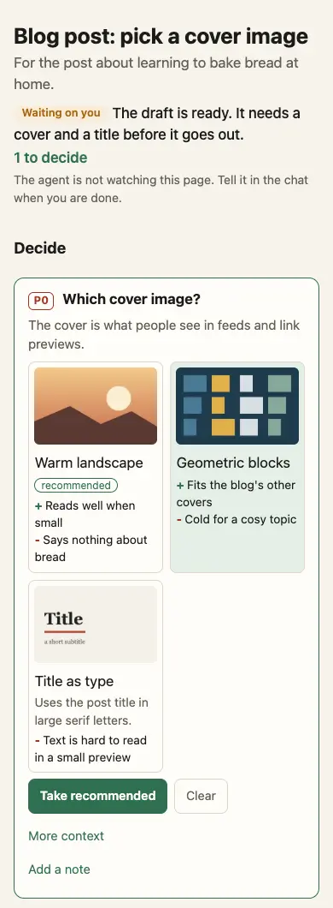

# decision-board

An agent skill. When your coding agent has questions for you, it publishes them as a small
private page you answer on your phone: one card per decision, the recommended answer one tap
away, the background behind "More context" for when you do not remember the details. The agent
notices your answers, acts on them, and updates the page.



It works for code reviews and release plans, and just as well for "which of these three cover
images" or "which headline". The page also shows what you should test, what was done and what
comes next, and has a box where you can tell the agent anything, as you would in the chat.

## What it needs

1. Node.js 18 or newer. No `npm install`, no build step.
2. The [nsite-artifacts](https://nsite-clay.cypherpunk.today/) skill, unzipped next to this one
   (the same parent folder). It publishes the page encrypted, with the key inside the link.
   It needs outbound HTTPS and WebSocket, and a settings folder that survives between sessions.
3. An agent that can run commands. Claude Code, Codex, or anything else that reads skills.

## Install

Unzip `decision-board.zip` into your agent's skills folder, next to `nsite-artifacts`.

Optional: create `~/.config/decision-board/config.json` to set your language, how long the agent
keeps checking by default, and a command that sends you a message (it gets the text on stdin):

```json
{
  "watch": { "default": "24h" },
  "notify": { "command": ["my-send-message"], "includeEditLink": true },
  "ownerNpub": "npub1..."
}
```

Every message then carries the page's edit link. With `ownerNpub` your Nostr key is also a member
of each page, so you can still open it by signing in if you lose the link. All keys are in
`references/config.md`.

## How the agent watches

Checking for a change asks a relay for one small event and compares a hash. Nothing is
downloaded and no model runs until something changed. Then the agent reads only the difference.
How the agent gets woken depends on your harness: a background command, a scheduler, or simply
the next time you write to it. See `references/watching.md`.

## Security

- The edit link is a key. Whoever has it can read the page and answer it, including the box that
  tells the agent what to do. Send it only to yourself. The agent asks in the chat before
  anything risky that the box asks for (deleting, deploying, publishing, spending, sending).
- A project may ship `decision-board.config.json`, but it can only set the language, expiry and
  watch times. Commands and your npub are read only from your own settings file.
- The page refuses to carry keys or keyed links.

## Files

- `SKILL.md`: what the agent reads.
- `scripts/board.mjs`: validate, build, publish, pull, push, watch.
- `scripts/config.mjs`, `scripts/notify.mjs`, `scripts/watch.sh` (kept for 0.2 sessions).
- `references/`: schema, watching, settings, harness notes.
- `assets/examples/`: an audit board and a cover image board.
- `locales/sk.json`: Slovak page labels.

License: MIT-0.
